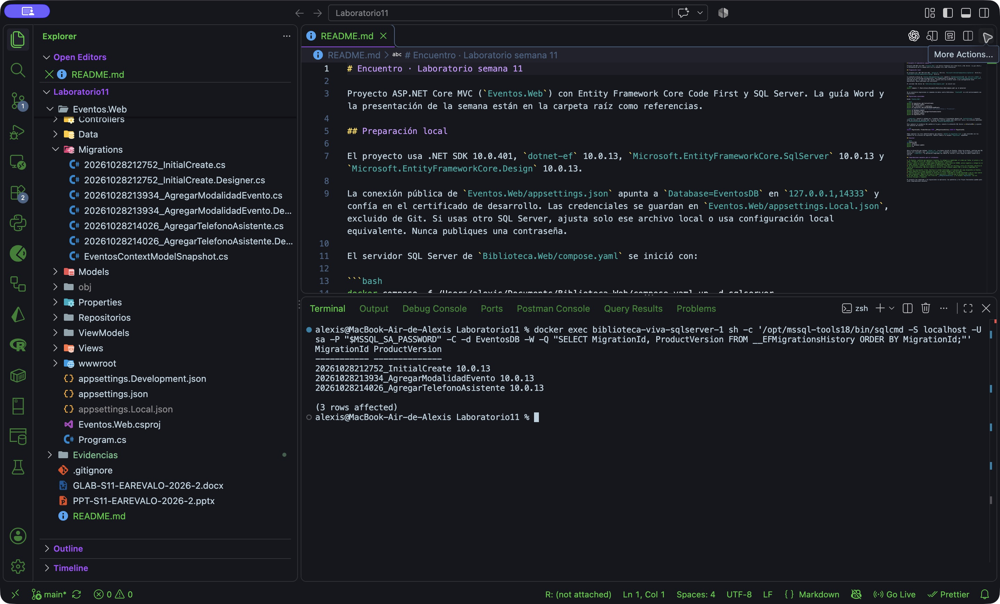
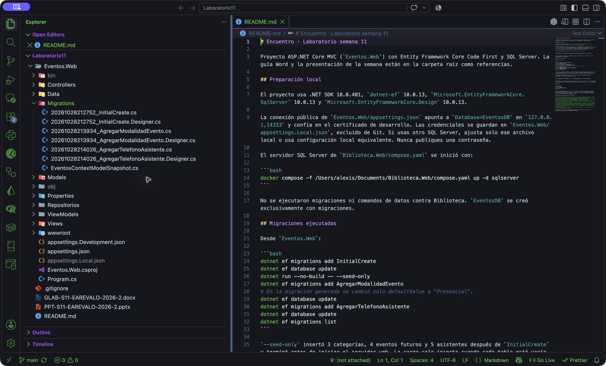

# Evidencia de migraciones

Las capturas provienen del proyecto en VS Code y de una consulta de solo lectura a `EventosDB` mediante `sqlcmd` dentro del contenedor SQL Server.

## Historial de la base de datos

```sql
SELECT MigrationId, ProductVersion
FROM __EFMigrationsHistory
ORDER BY MigrationId;
```

| MigrationId | ProductVersion |
| --- | --- |
| 20261028212752_InitialCreate | 10.0.13 |
| 20261028213934_AgregarModalidadEvento | 10.0.13 |
| 20261028214026_AgregarTelefonoAsistente | 10.0.13 |



## Carpeta Migrations

La carpeta incluye los tres archivos de migración, sus tres archivos Designer y `EventosContextModelSnapshot.cs`. Los identificadores coinciden con las filas de la tabla.


